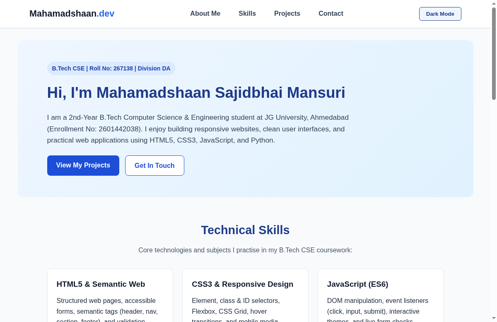

# Personal Portfolio Website — Mahamadshaan Mansuri (267138)

This repository contains my personal portfolio website created for the **Web Technology (`BTECHCSE240301`)** Internal Assessment at **JG University, Ahmedabad**.

- **Student Name:** Mansuri Mahamadshaan Sajidbhai
- **Enrollment Number:** `2601442038`
- **Roll Number:** `267138`
- **Division:** `DA` (2nd Year B.Tech CSE - D2D)
- **GitHub Repository Link:** [https://github.com/ShaanMansuri224/Mahamadshaan_267138_Portfolio](https://github.com/ShaanMansuri224/Mahamadshaan_267138_Portfolio)
- **Live Website (GitHub Pages):** [https://shaanmansuri224.github.io/Mahamadshaan_267138_Portfolio/](https://shaanmansuri224.github.io/Mahamadshaan_267138_Portfolio/)

## Project Overview

A responsive, custom-built personal portfolio website showcasing my academic background, technical skills, featured coursework projects, and an interactive contact form.

## Sections & Features Included

1. **Home / About Me:** Introduction, B.Tech CSE academic profile at JG University, and quick navigation buttons.
2. **Technical Skills:** HTML5 & Semantic Web, CSS3 & Responsive Design, JavaScript (ES6), and Python & Problem Solving.
3. **Featured Projects:**
   - **CampusCare Issue & Attendance Tracker:** Web utility interface to log lecture attendance counts and report campus facility requests (`HTML5`, `CSS3 Grid`, `JavaScript Events`).
   - **Smart Student Registration & CGPA Calculator:** Interactive web form and semester grade calculator with real-time input listeners and compulsory field validation (`Semantic HTML Forms`, `CSS Flexbox`, `Vanilla JS`).
   - **Responsive Personal Portfolio Website:** Custom-coded portfolio featuring a dark mode toggle, mobile navigation menu, and client-side contact form validator (`HTML5`, `CSS3 Media Queries`, `JavaScript DOM`).
4. **Interactive Contact Form:** Client-side validation for Full Name, Email Address, and Message minimum length, plus a live character counter.

## Technologies Used

- **HTML5 (`index.html`):** Semantic layout (`<header>`, `<nav>`, `<section>`, `<article>`, `<form>`, `<footer>`).
- **CSS3 (`style.css`):** Element, class, and ID selectors, Flexbox/Grid layouts, `:hover` effects, dark mode theme, and `@media (max-width: 768px)` mobile responsiveness.
- **JavaScript (`script.js`):** Dark Mode / Light Mode toggle, Mobile menu toggle, and Contact Form validation with live character count using `addEventListener`.

## Portfolio Output Screenshot

Direct Screenshot Link: [View Portfolio Screenshot](https://raw.githubusercontent.com/ShaanMansuri224/Mahamadshaan_267138_Portfolio/main/portfolio_screenshot.png) 
